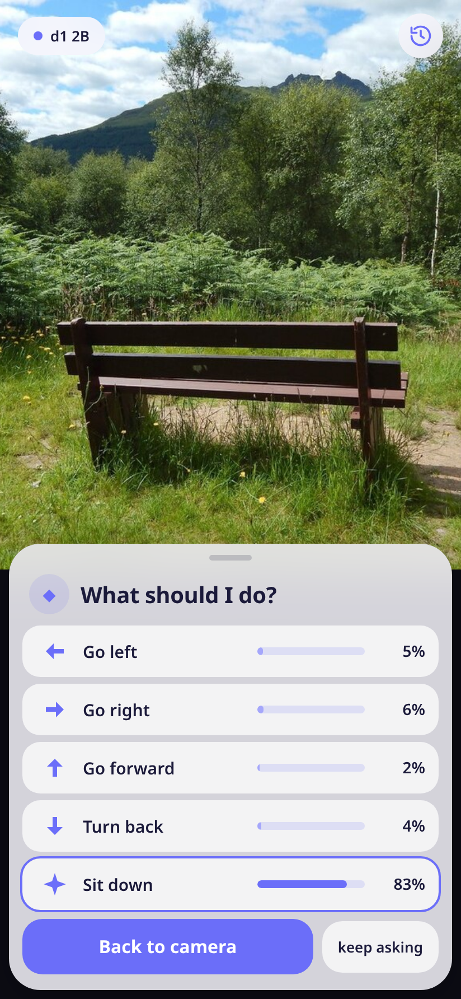
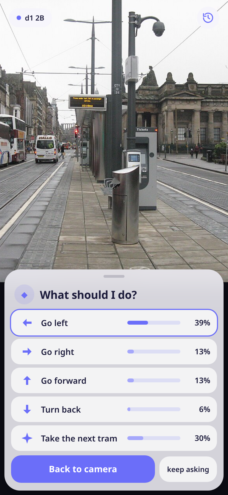

# decide me

No more decisions!

You walk around the world, point your phone at it, and a decision model tells you what to do
next. Where to go: go left 39 %, go right 13 %. Or the one thing worth doing right here: take the
next tram, sit down, go inside, talk to someone. The model does not have to pick it, but when it
does, that is what you do. You just enjoy the walk.

The model runs inside the phone ([kneejerk](https://github.com/moudrkat/kneejerk), llama.cpp in
the app). It looks at the picture, and nothing leaves the phone. It is a multimodal decision model:
no chatting, no explaining, just probabilities.

<p>


</p>

The app's screen in a desktop browser, with the answers d1 2B gave for these two photos through the
same library. Not a phone yet. Photos: Lairich Rig and M J Richardson, CC BY-SA 2.0, via Geograph and
Wikimedia Commons ([bench](https://commons.wikimedia.org/wiki/File:Bench_beside_path_-_geograph.org.uk_-_4114984.jpg),
[tram stop](https://commons.wikimedia.org/wiki/File:Princes_Street_tram_stop,_Edinburgh.jpg)).

I said I would not build this. I have discipline. 😇

(I built it the same morning. You don't need to decide that often in real life anyway.)

## Install

Android only for now.

1. On the phone, open the [releases page](https://github.com/moudrkat/decide-me/releases), tap `decide-me.apk`.
2. Allow installs from this source, install, allow the camera.
3. Pick a model: **d1 2B** (1.3 GB with its projector) decides better, **d1-omni 600M** (670 MB) is the lighter one.
4. Point the camera somewhere. **What should I do?**

## What it does

- Takes one small frame from the camera (320 px) and asks the model for one decision: go left,
  go right, go forward, turn back, or the one thing worth doing here. The model does not have to pick the thing.
- The thing is one of 21: sit down, go inside, talk to someone, take the next tram,
  lie down, look at the art, open a book, eat something… Which actions, and how to ask each model,
  was measured on 672 photos of 56 kinds of places: [calibration](calibration/).
- **keep asking** asks again every five seconds, for the fully automated life.
- The history button shows where it has sent you so far.

The pictures are checked against llama-server: the same photo and questions give the same
probabilities to four decimals (kneejerk, `tests/results_images_2026-11-11.txt`). Whether the
model is *right* about your street is a different question. Actually, wait. Let's ask the
decision model first.

## Build it yourself

Node 22, Android SDK with NDK 27 and cmake, JDK 21.

```bash
git clone --recurse-submodules https://github.com/moudrkat/kneejerk
git clone https://github.com/moudrkat/decide-me
cd decide-me && npm install && npm run build && npx cap sync android
cd android && ./gradlew assembleDebug
```

## PRs welcome

Your own questions and actions, numbers from your phone, iOS.
